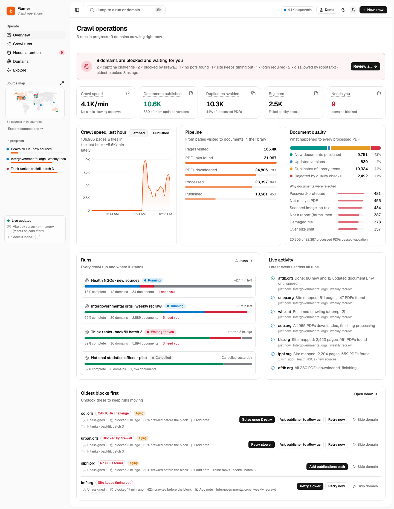
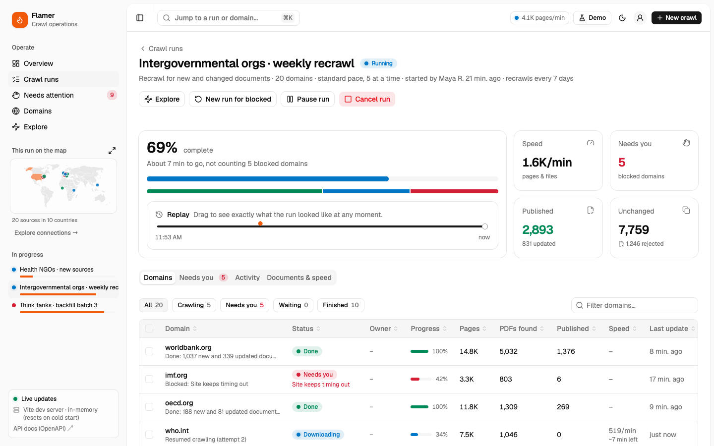
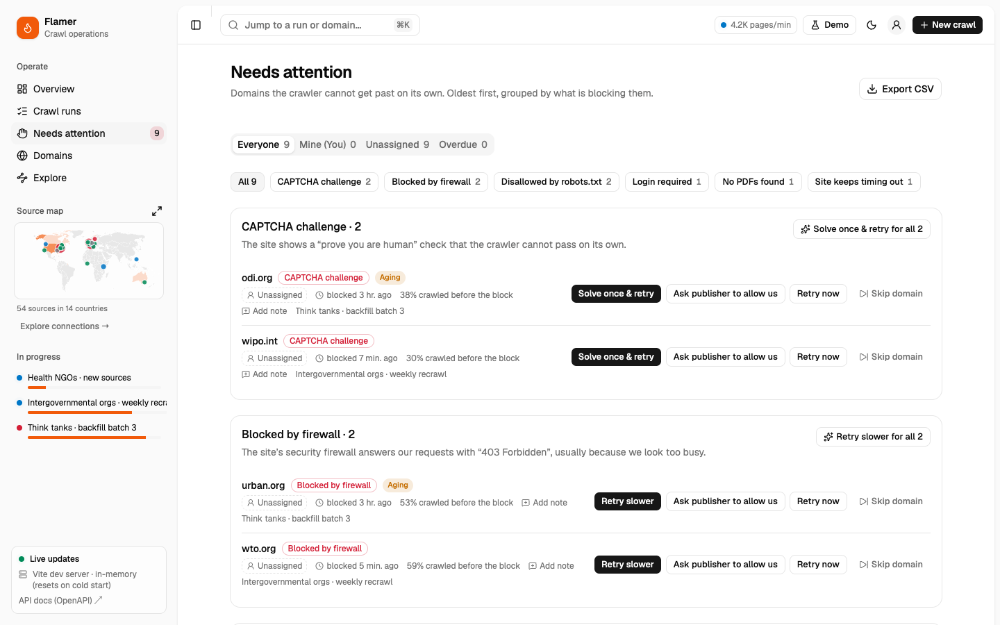
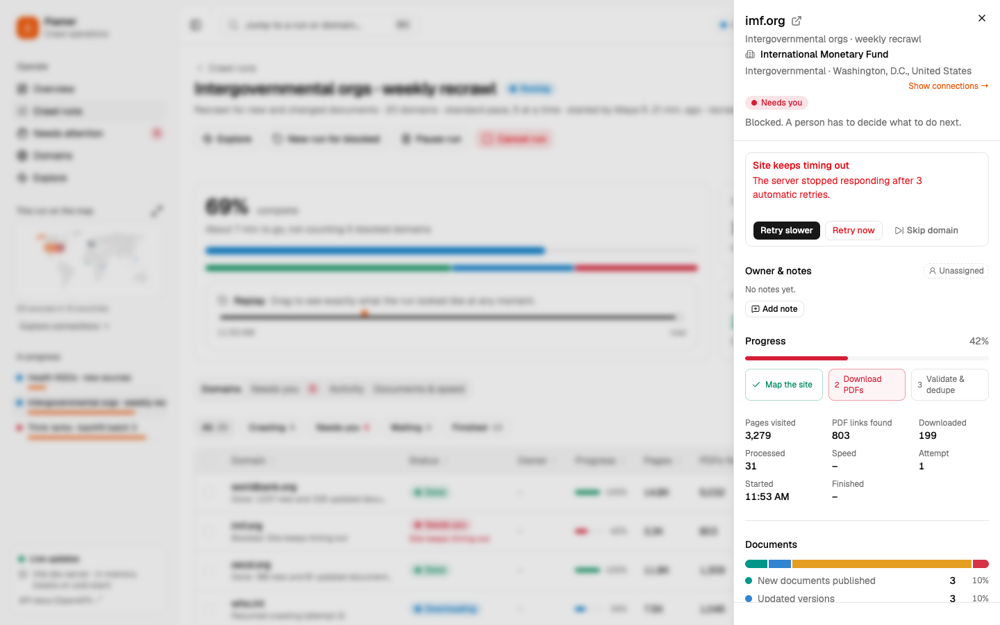
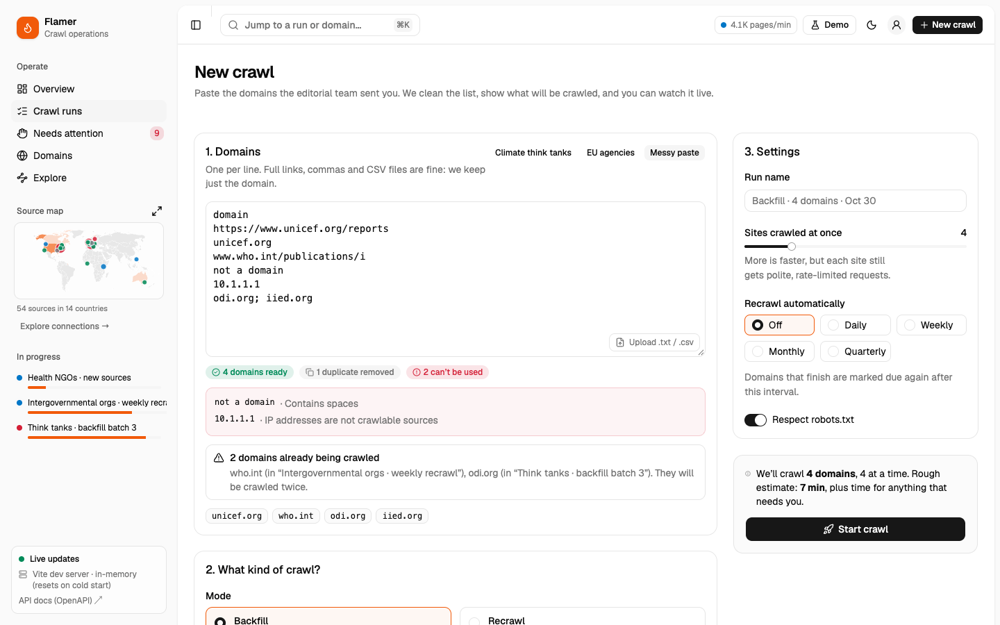
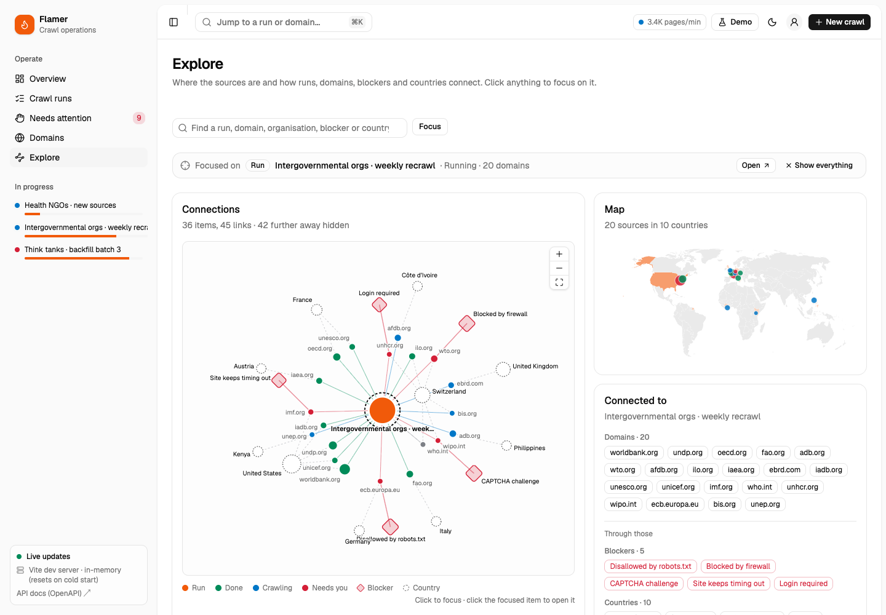
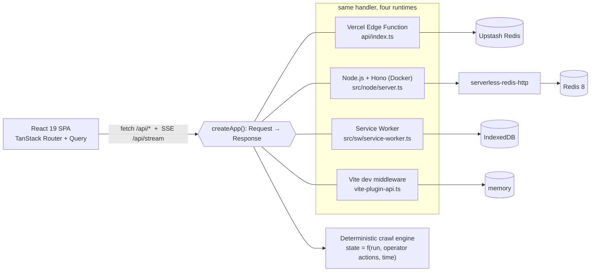

# Flamer · crawl operations dashboard

A control room for the **content operations** team. Paste the domains the editorial team sent, start a crawl, and watch it live:
what is running, how fast, what reached the library, and, above all, **which domains are stuck and what to do about them**.

The crawler is simulated, but it is backed by a real API that runs the same way on Vercel’s edge, in a Node server
(Docker), inside a Service Worker (GitHub Pages) and in the Vite dev server, plus a **Python (FastAPI + Postgres)
implementation of the same API** that is proven identical against shared golden fixtures.

| Live demo                              |                                                   |
| -------------------------------------- | ------------------------------------------------- |
| Vercel (edge API + Redis)              | https://flamer-dashboard.vercel.app               |
| GitHub Pages (API in a Service Worker) | https://alexandarndre.github.io/flamer-dashboard/ |



## What a content-ops person can do

|                                                |                                                                                                                                                                                                                                                                                                                                                                                                                                                                                       |
| ---------------------------------------------- | ------------------------------------------------------------------------------------------------------------------------------------------------------------------------------------------------------------------------------------------------------------------------------------------------------------------------------------------------------------------------------------------------------------------------------------------------------------------------------------- |
| **Start a crawl**                              | Paste a list or drop a `.txt`/`.csv`. Links, `www.`, commas and CSV headers are cleaned up; duplicates and unusable entries are explained line by line; domains already being crawled in another run are flagged. Choose _backfill_ (new sources) or _recrawl_ (only new/changed documents), a pace and how many sites run at once.                                                                                                                                                   |
| **See the state at a glance**                  | Overview with crawl speed, documents published, duplicates avoided, rejections, a pipeline funnel (pages → PDFs → downloaded → processed → published), document quality with rejection reasons, a live activity feed and every run with a status bar.                                                                                                                                                                                                                                 |
| **Get told when something blocks**             | Live toasts (“who.int needs attention: CAPTCHA challenge”) with a _Review_ button, a badge in the sidebar and the browser tab title.                                                                                                                                                                                                                                                                                                                                                  |
| **Unblock without an engineer**                | The _Needs attention_ inbox groups blocked domains by cause, explains each in plain language and puts the recommended fix first: _Solve once & retry_, _Retry slower_, _Use partner login_, _Add publications path_, _Ask the publisher_… Fixes can be applied to a whole group in one click. Publisher requests go into a _waiting on publisher_ state and are answered (approved or declined) a few minutes later.                                                                  |
| **Drill into one domain**                      | A drawer with the crawl stages, counters, document outcomes and the domain’s own timeline.                                                                                                                                                                                                                                                                                                                                                                                            |
| **Steer runs**                                 | Pause / resume / cancel a run (with a reason that lands in the log); pause, resume, retry or skip domains individually or in bulk.                                                                                                                                                                                                                                                                                                                                                    |
| **Replay**                                     | Scrub any run back in time and see exactly what it looked like at that moment, with operator actions marked on the timeline.                                                                                                                                                                                                                                                                                                                                                          |
| **See where sources are and how they connect** | A source map in the sidebar follows what you are looking at: every source on most pages, only the current run inside a run, with the open domain highlighted. **Explore** shows the full map (countries shaded by number of sources, a bubble per headquarters city coloured by the most urgent status) next to a relationship graph of runs, domains, blockers and countries. Click anything to refocus on its two-step neighbourhood; the side panel lists what it is connected to. |
| **Find anything**                              | `⌘K` jumps to pages, runs, blocked domains and any domain ever crawled. Every view state (tab, filter, search, open drawer, replay time) lives in the URL, so a link can be pasted into Slack and opens the same view.                                                                                                                                                                                                                                                                |
| **Own the problems**                           | Assign a blocked domain to yourself or a teammate, leave notes on it, and filter the inbox by _Mine_, _Unassigned_ or _Overdue_. Blocks older than an hour are marked _Aging_, older than four hours _Overdue_.                                                                                                                                                                                                                                                                       |
| **Keep sources fresh**                         | A run can recrawl automatically (daily, weekly, monthly, quarterly). The Domains page shows when each source is next due and starts a recrawl of everything due in one click.                                                                                                                                                                                                                                                                                                         |
| **Take data elsewhere**                        | Export blocked domains or the whole domain registry as CSV.                                                                                                                                                                                                                                                                                                                                                                                                                           |
| **Demo controls**                              | A _Demo_ button explains what is real and what is simulated, runs the clock 10× or 60× faster so a whole run finishes in a minute, resets the data, and starts a one-minute guided tour (shown automatically on the first visit). Every visitor works in a private sandbox.                                                                                                                                                                                                           |

| Run                                                  | Needs attention                              |
| ---------------------------------------------------- | -------------------------------------------- |
|                      |        |
|  |  |



### Vocabulary

The UI never shows HTTP codes or queue names first. Every state has a plain label plus a one-line explanation on hover.

| Domain status                           | Meaning                                                                                          |
| --------------------------------------- | ------------------------------------------------------------------------------------------------ |
| Queued                                  | Waiting for a free crawler slot                                                                  |
| Mapping site → Downloading → Processing | Following links and sitemaps, fetching PDFs, then validating, extracting text and de-duplicating |
| Auto-retrying                           | Rate-limited (429) or timing out; backing off and retrying on its own                            |
| Waiting on publisher                    | We asked the publisher for access; an answer is pending                                          |
| **Needs you**                           | Blocked; a person has to decide                                                                  |
| Paused · Done · Skipped · Cancelled     |                                                                                                  |

| Blocker                   | Recommended fix                        | Other options                    |
| ------------------------- | -------------------------------------- | -------------------------------- |
| CAPTCHA challenge         | Solve once & retry (reuse the session) | Ask publisher to allow us, retry |
| Blocked by firewall (403) | Retry slower                           | Ask publisher, retry             |
| Disallowed by robots.txt  | Request permission                     | (skip)                           |
| Login required            | Use partner login                      | Ask publisher                    |
| Domain not found          | Retry                                  | (skip)                           |
| Certificate problem       | Accept certificate                     | Retry                            |
| No PDFs found             | Add publications path                  | (skip)                           |
| Site keeps timing out     | Retry slower                           | Retry                            |

## How it works



**Event-sourced, deterministic simulation.** A run is stored as its spec (domains, mode, pace, concurrency, seed) plus an
append-only log of operator actions. The current state of every domain is a pure function of
`(spec, actions, time)`: a small discrete-event simulation (`src/server/sim/engine.ts`) replays slots, stages, back-offs,
blocks, publisher replies and operator actions up to the requested time. That gives us:

- **Stateless edge compute.** Nothing ticks in the background; any instance can answer any request.
- **Time travel for free.** `GET /api/runs/:id?at=<timestamp>` is the same function with an earlier time.
- **An audit log for free.** The action log _is_ the history (“Maya R. chose _Solve once & retry_”).
- **Testable behaviour.** Invariants like “never more active domains than the concurrency limit”, “counters never go down”
  and “a paused run doesn’t move” are unit tests (`tests/engine.test.ts`).

Each domain has a stable personality derived from a hash of its name (size, PDF ratio, how often it rate-limits, whether it
tends to show a CAPTCHA…), so the same site behaves consistently across runs. Each remedy has a realistic success rate.

**One handler, four runtimes.** `src/server/app.ts` is a Web-standard `(Request) => Promise<Response>` router: no Node
APIs, Zod-validated bodies, typed errors (400/404/409). It runs unchanged as a Vercel Edge Function, in a Node.js server
(Hono) for Docker, inside a Service Worker for the static GitHub Pages build, and as Vite middleware in development. In the Pages build the API calls still
show up in the browser’s Network tab, because the Service Worker answers them. If a hard refresh bypasses the worker, the
app runs the same handler in the page.

**Live updates.** `GET /api/stream` is Server-Sent Events built on a `ReadableStream`: a `pulse` every 2 s (counts, speed,
per-run progress) and `activity` batches of new events. The client parses the stream with `fetch` (so it works through the
Service Worker too), keeps a tiny external store (`useSyncExternalStore`) and uses each pulse to invalidate the active
TanStack Query caches. If the stream drops, queries fall back to polling and the sidebar shows _Reconnecting…_.

### Stack and the modern bits used

- **React 19.3**: Actions (`useActionState`, `useFormStatus`) for the new-crawl form, `useOptimistic` + `useTransition` for
  instant “Retrying…” feedback on every action, `use()` to suspend until the backend transport is ready,
  `useEffectEvent` for the live-stream callback, `useDeferredValue` for filtering, `<Activity>` to keep run tabs alive
  while hidden, and `<ViewTransition>`.
- **React Compiler 1.0.** No hand-written `useMemo`/`useCallback`. One opt-out (`'use no memo'`) in the TanStack Table
  component, whose state is read through stable methods the compiler would otherwise cache.
- **TanStack Router**: type-safe routes, search params validated with Zod as the source of truth for UI state, data
  preloaded on hover/intent, route-level code splitting, view transitions between pages.
- **TanStack Query v5** (cache, SSE-driven invalidation), **TanStack Table v9** (sorting, shift-click range selection) +
  **TanStack Virtual** for long domain lists.
- **shadcn/ui** (Radix base, _nova_ preset) on **Tailwind CSS v4** with OKLCH design tokens (brand, status tones and chart
  colours for light and dark), Recharts via shadcn charts, Sonner toasts, cmdk palette.
- **Zod 4** contract in `src/shared` shared by server and client.
- **d3-geo** + **world-atlas** TopoJSON for the map (loaded on demand with `use()`), **d3-force** for the graph layout,
  rendered as plain React SVG with CSS-transitioned node positions.
- **Vite 8 (Rolldown)**, strict TypeScript with project references for the app, the Node tooling and the Service Worker
  (`WebWorker` lib).
- **Yarn 4** with the `node-modules` linker, its default one-day quarantine of freshly published packages (a supply-chain
  guard) and a `packageExtensions` entry for a peer dependency `@tanstack/react-table` forgets to declare.
- **Vitest**: simulation invariants, API behaviour (including SSE and time travel) and the Redis store against a fake
  Upstash REST API.

## Run it locally

Requires Node 22.12+ and any `yarn` on the PATH. The repo pins **Yarn 4.18.1** in `.yarn/releases` (`yarnPath`), so a
global Yarn 1 or Corepack both end up running exactly that version.

```bash
yarn install
yarn dev             # http://localhost:5173 with the API served by Vite (in-memory, seeded on start)
yarn test            # unit + API + golden-fixture tests (Vitest)
yarn typecheck
yarn lint            # ESLint incl. React Compiler rules
yarn e2e             # Playwright browser tests (starts the dev server; PW_CHANNEL=chrome to use your Chrome)
```

Try the GitHub Pages flavour (API in a Service Worker, data in IndexedDB):

```bash
yarn build:pages
yarn preview:pages   # http://localhost:4173/Flamer-Dashboard/
```

## Deploy

### GitHub Pages (static; the backend runs in the visitor’s browser)

1. Create a GitHub repository and push this folder (`main` branch).
2. **Settings → Pages → Build and deployment → Source: GitHub Actions.**
3. Every push to `main` runs `.github/workflows/deploy-pages.yml`: install, test, build with the right base path
   (`/<repo>/`, taken from `actions/configure-pages`), copy `index.html` to `404.html` for deep links, deploy.

Every visitor gets their own seeded data in IndexedDB. Nothing is shared between visitors.

### Vercel (real edge API with shared, persistent data)

1. **Add New → Project → Import** the GitHub repository. Vercel detects Vite; `vercel.json` sets the Yarn install and
   build commands, the output directory and rewrites (`/api/*` → the edge function, everything else → the SPA).
2. **Storage → Create Database → Upstash for Redis** (free plan) and connect it to the project. Vercel injects
   `KV_REST_API_URL` and `KV_REST_API_TOKEN` (`UPSTASH_REDIS_REST_URL` / `UPSTASH_REDIS_REST_TOKEN` work too).
3. **Redeploy.** The sidebar footer should read _Vercel Edge Function · Upstash Redis_.

Without Redis the API still runs, but it keeps data in the memory of whichever edge instance answers, so runs can reset or
go missing. The app shows a warning banner in that case.

From the CLI instead (connect the Redis store in the dashboard as in step 2):

```bash
yarn dlx vercel link
yarn dlx vercel --prod
```

To reset the demo data, delete the `flamer:*` keys in the Upstash console; the API re-seeds on the next request.

### Docker Compose (self-hosted)

```bash
docker compose up --build        # http://localhost:3000
FLAMER_PORT=8080 docker compose up --build -d
docker compose down -v           # stop and wipe the data
```

`compose.yaml` runs three services:

- **app**: a multi-stage image (`Dockerfile`) that builds with Yarn, then runs only the static build plus one bundled
  server file (`dist-server/server.mjs`, no `node_modules`) on Node 24 Alpine as a non-root user. Hono serves the SPA with
  immutable caching for hashed assets and mounts the same API. It has a health check on `/api/health` and shuts down
  cleanly on `SIGTERM`.
- **redis**: Redis 8 with append-only persistence in the `redis-data` volume.
- **redis-http**: [serverless-redis-http](https://github.com/hiett/serverless-redis-http), an Upstash-compatible REST
  proxy in front of Redis. The container therefore uses exactly the same store code as the Vercel deployment.

The sidebar footer should read _Node.js server · Upstash Redis_. To run the same server without Docker:
`yarn build && yarn build:server && yarn start` (in-memory unless the `KV_REST_API_*` variables are set).

## Python backend (FastAPI + PostgreSQL)

`backend-python/` implements the same API in Python: FastAPI with Pydantic v2 models for the contract, SQLAlchemy 2.0
Core on asyncpg for PostgreSQL (append-only actions table, namespaced sandboxes, idempotent seeding), Alembic
migrations, SSE via async generators, and the deterministic engine ported with JavaScript number semantics.

It is **proven identical** rather than “similar”: `tests/test_conformance.py` reproduces every value in
`fixtures/golden.json` (12,706 of them, exact equality, int vs float included), and its API tests mirror the TypeScript
ones. The React UI runs against it unchanged.

```bash
cd backend-python
uv sync
uv run pytest                       # 94 tests; set TEST_DATABASE_URL to also run the Postgres store and API suite
uv run ruff check && uv run mypy    # lint, strict typing
docker compose --profile python up --build   # from the repo root: UI + Python API + Postgres on http://localhost:3001
```

See [backend-python/README.md](backend-python/README.md) for the layout and environment variables.

## Quality and delivery

| Layer         | What runs                                                                                                                                                                                                  |
| ------------- | ---------------------------------------------------------------------------------------------------------------------------------------------------------------------------------------------------------- |
| Static checks | Prettier, ESLint (typescript-eslint + React Compiler rules), strict TypeScript across app, tooling, Service Worker and tests                                                                               |
| Unit and API  | Vitest: simulation invariants, every endpoint (SSE, replay, sandboxes, demo clock, CSV, OpenAPI), the Redis store against a fake Upstash, and a **golden snapshot** of the engine (`fixtures/golden.json`) |
| Browser       | Playwright: the main journeys end to end, each in a fresh sandbox; tests tagged `@smoke` also run against the live sites                                                                                   |
| Python        | ruff, mypy `--strict`, pytest including the same golden fixture and Postgres-backed store tests                                                                                                            |
| Containers    | Both images are built and the Compose stack is started and probed in CI                                                                                                                                    |
| Delivery      | GitHub Actions on every PR and push; GitHub Pages deploy + live smoke test; Vercel previews per PR (“review apps”) + smoke test; Dependabot weekly with a 7-day cooldown                                   |

## API

| Method | Path                    |                                                                                                                                                                     |
| ------ | ----------------------- | ------------------------------------------------------------------------------------------------------------------------------------------------------------------- |
| GET    | `/api/health`           | Runtime and storage in use                                                                                                                                          |
| GET    | `/api/overview?at=`     | KPIs, pipeline totals, throughput, runs, open issues, recent events                                                                                                 |
| GET    | `/api/runs`             | Run summaries                                                                                                                                                       |
| POST   | `/api/runs`             | Create a run `{ name, mode, settings: { concurrency, pace, respectRobots }, domains[] }`                                                                            |
| GET    | `/api/runs/:id?at=`     | Full run state (per-domain snapshot, events, throughput), optionally at a past time                                                                                 |
| POST   | `/api/runs/:id/actions` | `pause_run` · `resume_run` · `cancel_run` · `{ type: pause \| resume \| retry \| skip \| resolve \| assign \| note, domains[], remedy?, assignee?, note? }`         |
| GET    | `/api/issues`           | Blocked domains across runs, oldest first                                                                                                                           |
| GET    | `/api/domains`          | Registry of every domain ever crawled                                                                                                                               |
| GET    | `/api/graph?focus=&at=` | Context graph: runs, domains, blockers and countries; with `focus` (`run:<id>`, `domain:<name>`, `blocker:<code>`, `country:<ISO>`) only its two-step neighbourhood |
| POST   | `/api/validate`         | Clean a pasted list and flag domains already in flight                                                                                                              |
| GET    | `/api/stream`           | Server-Sent Events: `pulse`, `activity`                                                                                                                             |

Also: `GET/POST /api/demo` (demo clock speed), `POST /api/demo/reset`, `GET /api/issues.csv`, `GET /api/domains.csv`,
`GET /api/openapi.json` and **`GET /api/docs`** (interactive API reference). The OpenAPI document is generated from the
same Zod schemas the server validates with.

Invalid input returns `400` with Zod’s error tree; actions that are not possible in the current state return `409` with a
readable message. Send `x-flamer-sandbox: <id>` (the UI does) to work in a private sandbox; without it you use the
shared dataset.

## Product decisions and assumptions

- **The user is content ops, not an engineer.** Labels describe outcomes (“Needs you”, “Waiting on publisher”), each block
  explains itself and offers concrete next steps, with the recommended one first.
- **Blocks are per domain; document problems are statistics.** Rejected PDFs (encrypted, scanned, not a real report…) are
  shown as reasons and counts, not as a review queue.
- **Recrawl vs backfill.** In a recrawl most documents are _unchanged_; the UI says “unchanged” instead of “duplicate”
  there.
- **Politeness by default.** robots.txt is respected unless explicitly turned off, with a warning.
- **Locations come from a curated table** of the sample publishers’ headquarters; any other domain is placed by its
  country domain (`.de`, `.gov.uk`, `.europa.eu`…) or left unplaced (generic `.org`/`.com`) rather than guessed.
- **Sample data uses real organisations’ domains** (grey-literature publishers). Their behaviour here is simulated and says
  nothing about the real sites.

## What I would do next for production

- Replace the simulator with the real pipeline: Postgres for runs, domain registry and the action log; workers publishing
  crawl events to a queue. The UI and API contract stay the same; the event stream becomes the source of truth.
- Authentication and roles (assignments and notes already exist; identities are just names today), Slack alerts for
  blocks that become overdue.
- Per-domain crawl policy editing (entry points, rate limits, credentials) and a scheduler that starts the due recrawls
  by itself instead of marking them due.
- A per-document quarantine for borderline PDFs.

## Project layout

```
api/index.ts                 Vercel Edge Function entry
src/node/server.ts           Node.js server (Hono) used by the Docker image
Dockerfile, compose.yaml     Container image and the app + Redis stack
src/server/                  Runtime-agnostic backend: router, aggregates, seed data
  sim/                       Deterministic crawl engine, domain profiles, PRNG
  store/                     Upstash Redis, IndexedDB and in-memory stores
src/sw/service-worker.ts     Service Worker hosting the API for GitHub Pages
src/shared/                  Zod contract, vocabulary, domain-list parsing, organisation & location lookup
src/lib/                     API client, transport selection, live stream, actions, formatting, theme
src/pages/                   Overview, runs, run detail, new crawl, needs attention, domains, explore
src/components/              App shell, domain table/drawer, charts, world map, relationship graph, replay, demo centre; ui/ is shadcn
tests/                       Vitest suites; fixtures/golden.json is the engine output both backends must reproduce
e2e/                         Playwright browser tests (@smoke ones also run against the live deployments)
backend-python/              FastAPI + PostgreSQL implementation of the same API (see its README)
.github/                     CI, GitHub Pages deploy + smoke test, Vercel smoke test, Dependabot
```
